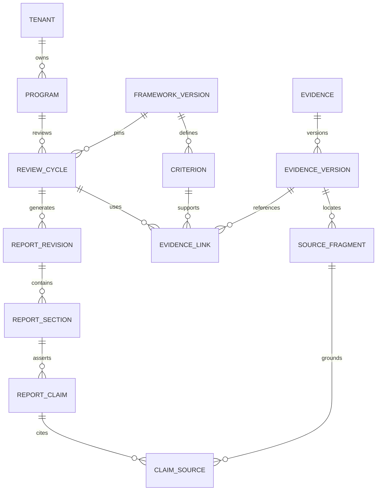

# Akreddit veri modeli

Statü: Uygulanacak mantıksal şema önerisi. Migration değildir. Alan bilgisi: L01, L19–L24; izolasyon yaklaşımı W08.

## Temel kurallar

Bütün müşteri verisi `tenant_id` taşır. Birincil kimlik UUID olabilir; yabancı anahtarlar kurum sınırını da doğrulamalıdır: `(tenant_id, program_id) → program(tenant_id, id)`. Sadece UUID kullanımı başka kurumun kaydına ilişki kurulmasını engellemez. Her hedefte bileşik benzersizlik bulunur.

Kurum içindeki program/ders yetkisi tenant kontrolünden ayrıdır. Kurum yöneticiliği, dış kullanıcıya ham öğrenci verisi açma yetkisini kendiliğinden vermez. Kullanıcı kimliği kimlik sağlayıcısı öznesine bağlanır; istemcinin gönderdiği rol veya kurum alanına güvenilmez.

## Varlıklar

| Tablo | Temel alanlar ve ilişkiler |
|---|---|
| `tenant` | id, name, status, policy_version_id |
| `identity` | id, issuer, subject; issuer+subject benzersiz |
| `membership` | tenant_id, identity_id, role, status |
| `program_grant` | tenant_id, identity_id, program_id, capability |
| `organizational_unit` | tenant_id, id, parent_id, kind, name |
| `program` | tenant_id, id, unit_id, stable_code, name, campus, delivery_mode, language |
| `academic_period` | tenant_id, id, year_label, term_label, starts_on, ends_on |
| `framework_version` | tenant_id, id, package_key, version, scope_type, status, source_hash, applicability |
| `criterion` | tenant_id, id, framework_version_id, parent_id, display_code, text, rubric_id |
| `criterion_crosswalk` | tenant_id, from_id, to_id, relation_type, rationale, approved_by |
| `review_cycle` | tenant_id, id, program_id, period_id, framework_version_id, status |
| `program_outcome_version` | tenant_id, id, program_id, stable_outcome_id, version, statement, status |
| `course` | tenant_id, id, program_id, code, name |
| `course_version` | tenant_id, id, course_id, version, ects, language, source_version_id |
| `course_offering` | tenant_id, id, course_version_id, period_id, cohort_code |
| `course_outcome_version` | tenant_id, id, course_version_id, stable_outcome_id, statement |
| `matrix_revision` | tenant_id, id, cycle_id, course_version_id, outcome_set_hash, status, revision |
| `matrix_cell` | tenant_id, matrix_revision_id, course_outcome_id, program_outcome_id, relation_status, score, rationale, run_id |
| `matrix_cell_source` | tenant_id, cell_id, fragment_id; gerekçe için kaynak ilişkisi |
| `evidence` | tenant_id, id, title, kind, owner_id, event_date, period_id, sensitivity, retention_policy_id |
| `evidence_scope` | tenant_id, evidence_id, program_id; ortak belgenin izinli kapsamları |
| `evidence_version` | tenant_id, id, evidence_id, version, object_key, sha256, media_type, size, processing_status |
| `source_fragment` | tenant_id, id, evidence_version_id, locator, extracted_text, extraction_method, quality_flags |
| `evidence_link` | tenant_id, id, cycle_id, criterion_id, evidence_version_id, role, rationale, review_status |
| `evidence_link_source` | tenant_id, evidence_link_id, fragment_id |
| `review_decision` | tenant_id, id, target_revision_id, target_kind, decision, reviewer_id, reason, created_at |
| `finding` | tenant_id, id, cycle_id, criterion_id, kind, statement, status |
| `finding_source` | tenant_id, finding_id, evidence_link_id |
| `improvement_action` | tenant_id, id, finding_id, owner_id, due_on, baseline, target, status |
| `action_evidence` | tenant_id, action_id, evidence_version_id, phase; plan/do/check/act |
| `report_revision` | tenant_id, id, cycle_id, revision, template_version, snapshot_id, status |
| `report_section` | tenant_id, id, report_revision_id, criterion_id, text, review_status |
| `report_claim` | tenant_id, id, report_section_id, text, claim_type |
| `claim_source` | tenant_id, claim_id, fragment_id veya calculation_run_id |
| `snapshot` | tenant_id, id, manifest_object_key, manifest_hash, frozen_at, frozen_by |
| `ai_run` | tenant_id, id, task_type, input_hash, provider, model_version, prompt_version, schema_version, status, usage, latency, estimated_cost |
| `job` | tenant_id, id, kind, target_id, input_version, attempt, status, error_code |
| `outbox_event` | tenant_id, id, aggregate_id, event_type, payload_ref, published_at |
| `audit_event` | tenant_id, id, actor_id, action, target, correlation_id, timestamp, metadata |
| `retention_policy` | tenant_id, id, version, category, duration, trigger, legal_basis_ref, approved_by |
| `legal_hold` | tenant_id, id, evidence_id, reason, starts_at, released_at |
| `export_job` | tenant_id, id, snapshot_id, audience, status, expires_at, manifest_hash |

Standart paketinin müşterideki kullanımı tenant kapsamlı ve değişmez bir kopyadır. Küresel paket kataloğu ayrıca salt okunur tutulabilir; müşteri uyarlaması başka müşteriyi değiştiremez.

## Ölçme modülü için ikinci dilim

`assessment` → `assessment_item` → `item_outcome_mapping` → `assessment_observation` → `calculation_run` → `attainment_result`.

Gözlem; öğrenci takma kimliği, ders açılışı, ölçme maddesi, ham/azami puan, durum kodu ve veri kaynağını taşır. Gerçek kimliğe dönüş tablosu ayrı erişim alanındadır. `measurement_policy_version` ağırlık, eksik veri, kapsam ve eşik kararlarını içerir. Sadece hesaplanmış yüzdeleri tutmak yeniden üretilebilirliği bozar.

## İlişkiler

## Zorunlu bütünlük kısıtları

- `(tenant_id, framework_version_id, display_code)` benzersiz; display_code sistem genelinde benzersiz değildir.
- Alt ölçütün üstü aynı paket sürümünde olmalıdır. Döngülü hiyerarşi yayın sırasında reddedilir.
- Kanıt bağlantısındaki ölçüt çevrimin paketine; kanıtın kapsamı çevrimin programına ait olmalıdır.
- Matris hücresindeki ders ve program çıktıları revizyonun sabitlediği kümeye ait olmalıdır.
- `related` için tam sayı 1–5; diğer durumlarda `score IS NULL`.
- Kaynak parçaları bağlandıkları belge sürümüne ait olmalıdır; dosya adından referans kurulmaz.
- Bir revizyonda aynı çıktı çifti tek hücredir. Onaylı hücre değiştirilmez; yeni revizyon oluşturulur.
- Onaylanan hedef revizyon mevcut revizyonla aynı olmalıdır. Optimistic locking kullanılır.
- `claim_source` içindeki fragment veya hesaplama referansından tam biri dolu olur.
- Hukuki saklama engeli bulunan belgenin gerçek silinmesi engellenir.
- Tenantlar arası yabancı anahtar ve programlar arası izinsiz bağlantı hem API hem veri katmanında reddedilir.

`target_kind/target_revision_id` gibi çok biçimli ilişkiler otomatik FK sağlamaz. Migration aşamasında tür başına bağlantı tablosu veya kısıtlı bir revizyon üst tablosu seçilmeli; ilişki yalnız serbest JSON'a bırakılmamalıdır.

## Saklama ve arama

Dosya içeriği özel nesne deposunda, metadata PostgreSQL'de bulunur. OCR ve parçalar erişim kontrollüdür. Vektör araması eklenirse tenant, program yetkisi, kaynak sürümü ve silinme durumu sorgu öncesi filtrelenir. Çıktı sonradan süzülerek izolasyon sağlanmış sayılmaz. Tenant ve sık kullanılan kapsam/sürüm alanlarına indeks konur.

Kişisel içeriğin tamamı audit log'una kopyalanmaz. Audit için kimlik, eylem ve değişiklik özeti yeterlidir; hassas eski/yeni değerler gerekiyorsa ayrı kısıtlı depoda tutulur. Log saklama politikası da belirlenir.
