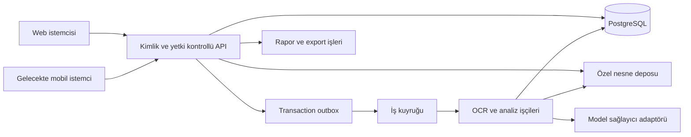

# Mimari ve API taslağı

Statü: Önerilen başlangıç mimarisi. Kullanıcı tarafından belirlenmiş tek teknoloji zorunluluğu yoktur; mobil genişleme hedefi korunur. Paket sürümleri uygulama başında resmî dokümanlardan doğrulanıp kilitlenir.

## Başlangıç kararı

Modüler monolit API, web istemcisi ve ayrı çalışan belge işçileriyle başla. Alan sınırlarını modüllerde koru; trafik veya ekip ihtiyacı oluşmadan mikroservis ağı kurma. OCR ve rapor işleri HTTP isteğini bekletmeden kuyruğa alınır.

Önerilen yığın: web için TypeScript/React tabanlı Next.js; API ve belge işçileri için Python/FastAPI; PostgreSQL; özel S3 uyumlu nesne deposu; dayanıklı iş kuyruğu; OIDC uyumlu kimlik sağlayıcısı. Bunlar ürün kararı önerisidir, mevcut kurulum değildir. Alternatif yığın seçilirse aynı API ve güvenlik sözleşmeleri korunur.



Modüller: identity-access, organizations, standards, curriculum, evidence, assessment, reporting, improvement, audit, billing-usage. Web doğrudan veritabanına veya model sağlayıcısına erişmez. Sağlayıcı anahtarları sunucudadır.

## API ilkeleri

`/v1` altında JSON; OpenAPI sözleşmesi; UTC zaman damgaları ve kullanıcıya yerel gösterim; UUID kimlikleri; cursor pagination; makinece işlenebilir hata kodları. Akademik dönem string tarihten tahmin edilmez.

Web güvenli oturum çerezleri ve CSRF koruması; mobil OIDC yetkilendirme kodu + PKCE önerilir. Mobil tokenlar işletim sisteminin güvenli deposunda tutulur. Kurum seçimi etkin üyelikle doğrulanır; `X-Tenant-Id` tek başına güven sınırı değildir.

| Uç | Davranış |
|---|---|
| `GET /v1/me/workspaces` | Yetkili kurum ve programlar |
| `POST /v1/programs/{id}/cycles` | Paket ve dönemi sabitlenen çevrim |
| `POST /v1/programs/{id}/uploads` | Boyut/tür niyeti; sunucu id'li yükleme oturumu |
| `POST /v1/uploads/{id}/complete` | Nesne doğrulama ve iş başlatma; 202 job id |
| `GET /v1/jobs/{id}` | Yetkili kullanıcıya durum ve güvenli hata |
| `GET /v1/evidence/{id}/versions/{version}` | Metadata ve yetkili kaynak görünümü |
| `POST /v1/evidence/{id}/classification-runs` | Paket sürümüne göre aday etiket işi |
| `POST /v1/evidence-links/{id}/decisions` | Onay/red/düzeltme; beklenen revizyon zorunlu |
| `POST /v1/cycles/{id}/matrix-runs` | Sürümlü çıktılarla matris işi |
| `POST /v1/matrix-revisions/{id}/decisions` | İnsan inceleme kararı |
| `POST /v1/cycles/{id}/report-runs` | Yalnız onaylı kaynaklardan bölüm taslağı |
| `POST /v1/report-revisions/{id}/freeze` | Kaynak sürümleri doğrulanarak snapshot |
| `POST /v1/snapshots/{id}/exports` | Yetki ve gizlilik kontrolüyle paket işi |
| `POST /v1/improvement-actions` | Sorumlu, hedef, süre ve kaynak |

Yazma işlemlerinde `Idempotency-Key` desteklenir. Anahtar tenant+actor+route kapsamındadır; istek gövdesi hash'i eşleşirse aynı sonuç döner. Aynı anahtar farklı gövdeyle kullanılırsa 409. Onay gibi değişikliklerde `If-Match`/revision kontrolü de gerekir; idempotency güncellik kontrolünün yerine geçmez.

Örnek hata:

```json
{"error":{"code":"SOURCE_REVISION_CHANGED","message":"Kaynak güncellendi. Öneriyi yeniden inceleyin.","request_id":"req-demo-1"}}
```

Yetkisiz nesne hakkında varlık bilgisi sızdırmayan 404 yaklaşımı tutarlı uygulanır. 401 oturum; 409 durum çakışması; 413 boyut; 415 tür; 422 alan doğrulama; 429 kota/hız sınırı için kullanılır.

## Güvenilir arka plan işleri

DB kaydı ile iş gönderimi arasındaki kaybı transaction outbox çözer. Kuyruk en az bir kez teslim edebilir; işçi `(tenant, task, input_version, configuration_hash)` üzerinden yinelenen çalışmayı tanır. Başarı ancak sonuç ve kaynak referansları birlikte kaydedilince verilir. Süre sınırı, sınırlı retry, geri çekilme, dead-letter ve kullanıcıya yeniden deneme bulunur.

İşçi her işte kurum ve program bağlamını yeniden kurar. Yalnız kuyruk payload'ındaki tenant id'ye güvenmez; iş kaydının yetkili kapsamını kontrol eder. Silinmiş veya sürümü değişmiş kaynağın gecikmiş sonucu aktif belgeyi değiştiremez.

## Mobil kanıt toplayıcı

İlk sürüm duyarlı web yüklemesi sunabilir. Sonraki SwiftUI/Kotlin istemcisi aynı upload/job API'sini kullanır. Çekim zamanı, kullanıcıca doğrulanmış olay tarihi ve sunucu kabul zamanı ayrıdır. EXIF konumu varsayılan olarak toplanmaz. Çevrimdışı kuyruk cihazda şifrelenir; tekrar bağlanmada idempotency ile yüklenir. Paylaşılan cihazda çıkış ve yerel taslak temizleme tasarlanır. Fotoğrafı çekmek onaylamak anlamına gelmez.

## Operasyon

Kurum bazlı depolama, sayfa, iş ve maliyet limitleri; model sağlayıcı kesintisinde manuel çalışma; loglarda hassas içerik maskeleme; yedek geri yükleme tatbikatı ve belge işleme gecikme ölçümü gerekir. RPO/RTO, hosting bölgesi ve hizmet seviyesi pilot sözleşmesi öncesi belirlenir. Bu paket altyapının kurulduğunu veya bu hedeflerin karşılandığını iddia etmez.
